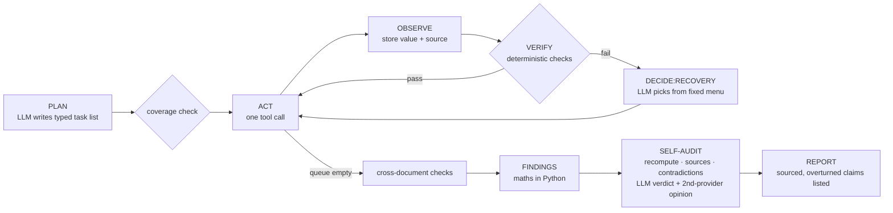

# Spend Radar

**An agent that tells a finance team where competitors out-invest them in people, and shows its work.** Every number in its report has a source, and before reporting, the agent tries to disprove its own findings.

Built solo by team **qwep** (Akarsh Dhingra) during **neatHack**, 10–12 Oct 2026. Uses **neatlogs** (tracing), **Entire** (checkpoints + code graph) and **cfo.ai** (business plan).

> The company in the demo, *Acme Observability Inc.*, is **fictional**. Its finance files are generated by `scripts/make_acme_data.py`. The competitors are real; their data comes live from Crustdata.

<!-- GIF of a run goes here (step 14) -->

## The problem

Finance teams budget against their own ledger, not the market. They find out a competitor doubled its ML team, or that their own marketing team is out of line with peers, a quarter too late. The data exists (headcount by function, hiring, funding), but turning it into a budget comparison you can defend takes days of manual work.

## What the agent does, end to end

**Input:** a folder of finance files (a budget spreadsheet, invoice PDFs, a spend policy, a salary table) and a list of competitors.
**Output:** `runs/<id>/report.md`, which contains:
- **per category** (engineering, ML/AI, sales, marketing): Acme's share of headcount vs the competitor median range, whether the policy is met, and the gap in people and dollars (an estimate)
- **internal checks:** budget and invoice totals that don't add up, mis-categorised invoices, infra invoices over budget
- an **Overturned claims** section, listing findings the agent disproved itself
- a numbered **source for every number** (file + sheet/row/page, or Crustdata endpoint + field + fetch time)
- the **recovery log** (what failed, the options, what the LLM chose, and what a fixed rule would have chosen)

## How it works



**Who decides what.**
- **The LLM decides:** the plan, which recovery action to take from a fixed menu (`reparse_alt`, `narrow_range`, `fetch_more_signal`, `substitute_competitor`, `mark_low_confidence`, `skip`), and the audit verdicts.
- **Python decides:** how tasks run, **all arithmetic**, retry caps (3 per task), Crustdata credit caps (60 per run), and LLM quota.

| Focus area | How it shows up | Trace |
|---|---|---|
| Planning | `plan` span: an LLM task list validated against a Pydantic schema; `verify:plan_coverage` adds anything the plan missed | `288f07d84bb84e15754a241eef40d779` |
| Tool use | list_files, read_spreadsheet, read_pdf (text / LLM), crustdata_company, crustdata_jobs, classify_titles; each is a `TOOL` span | same |
| State | `RunState` saved atomically after every step (`runs/<id>/state.json`) | — |
| Context | every figure keeps its source; the report cites them | — |
| Execution | one tool per task; tasks whose inputs aren't ready are deferred | — |
| Recovery | `decide:recovery` spans record the options offered, the choice, the rule default, and the reason; fallback across models/providers; Crustdata backoff + stale-cache fallback; resume after a crash | `evidence/recovery/` |
| Verification | totals within 1%, ≥ 2 independent signals, signal agreement, vendor-category consistency, no unsourced numbers | `verify:*` spans |
| Iteration | case studies with before/after runs | `evidence/case-studies/` |

**Confidence is computed, never typed in:** `confidence = checks × signals × freshness` (`spendradar/verify.py`).
- `checks` = passed / total checks behind the finding.
- `signals` = min(1, n_signals / 2) × agreement between signals.
- `freshness` = 1 up to 90 days old, falling to 0.5 at 365 days.
- An audit downgrade halves the score; an overturn sets it to 0.

## How we used the three tools

### neatlogs: tracing is the debugger
- Every Gemini call is auto-traced (`instrumentations=["google_genai"]`). OpenRouter calls, tool calls, `verify:*`, `decide:recovery`, `fallback:<model>`, `audit:<finding>` and `fault:injected:*` are custom spans.
- Runs are tagged `sha:<commit>`, `run:<id>`, `variant:<label>`, `evidence`, `inject:<fault>`, `fixture`. `session_id` = run id, so a resumed run groups with its first trace.
- Secrets are masked client-side before export (`mask=` callback, unit-tested).
- **Every bug fix below started from a trace.** Trace list: [`evidence/traces.md`](evidence/traces.md).

### Entire: context for the coding agent
- Every commit by the coding agent carries an `Entire-Checkpoint` trailer that links it to the prompt and transcript behind it. Checkpoints are pushed with the repo.
- `entire graph search` / `impact` were used to locate and size changes, e.g. the callers of `decide_recovery` before changing the recovery menu.
- Evidence: [`evidence/entire/`](evidence/entire/).

### cfo.ai: a business plan from measured costs
- Unit costs are **measured**: tokens per run from evidence runs × the published paid price of the same model. We developed on free tiers, so actual spend was $0.
- Inputs: [`business/inputs.md`](business/inputs.md), [`business/unit_costs.md`](business/unit_costs.md). The cfo.ai plan export goes in `business/`.

## Results so far

All numbers come from scorecards in [`evidence/evals/`](evidence/evals/).

| Run | Commit | Planted errors caught | Unsupported numbers | Peers kept | Crustdata credits |
|---|---|---|---|---|---|
| 1010-b31657 (before fix) | 11a5108 | 5/5 | 0 | 2/5 | 26.6 |
| 1010-7bf26d (after fix, evidence) | 22f00b0 | 5/5 | 0 | 5/5 | 5.4 |

Case studies (each n = 1 per side, with caveats stated):
- [01: reasoning calls took ~2 minutes each](evidence/case-studies/01-unbounded-llm-latency.md). Mean reasoning-call latency went from 120.9 s to 6.5 s after adding a per-call timeout with fallback.
- [02: one weak category threw away 3 of 5 peers](evidence/case-studies/02-competitor-substitution.md). Substitutions went from 3 to 0, and credits from 26.6 to 5.4.

Paid-equivalent cost per run (n = 1): **$0.0692 LLM + 20.8 Crustdata credits** with no cache.

## Run it yourself

```bash
uv sync                                  # Python 3.12
cp .env.example .env                     # NEATLOGS_API_KEY, GEMINI_API_KEY, OPENROUTER_API_KEY, CRUSTDATA_API_KEY
uv run python scripts/make_acme_data.py  # regenerate the fictional data (already committed)
uv run python -m spendradar run data/acme             # full run → runs/<id>/report.md
uv run python -m spendradar run data/acme --evidence  # LLM cache off, tagged as evidence
uv run python -m spendradar run data/acme --inject crustdata:429 --inject llm:429
uv run python -m spendradar run data/acme --crash-after-step 15 && uv run python -m spendradar resume <id>
uv run python -m spendradar eval --n 3 --evidence     # scorecard → evidence/evals/
uv run python -m spendradar ledger                    # today's free-tier quota use
uv run pytest
ln -sf ../../scripts/pre-commit .git/hooks/pre-commit # gitleaks + .env-value secret scan
```

## Limitations (honest)

- **Estimates.** Competitor people cost = Crustdata headcount by role × *Acme's* loaded cost (an assumption, `data/acme/salary_table.csv`). The comparison covers **people cost only**; infra/cloud is checked against Acme's own budget only.
- **ML/AI is the weakest estimate.** Crustdata has no ML role, so ML share comes from LLM-classified job titles. The self-audit overturned the ML/AI finding in runs 1010-b31657 and 1010-a32118, and downgraded it in 1010-7bf26d.
- **Fictional company data.** Acme and its vendors are invented; only competitor data is real.
- **Crustdata coverage.** Function timeseries for large companies stop at 2025-11 (the freshness penalty applies). Chronosphere has no hiring data.
- **Free LLM tiers.** Development ran on Gemini free tier and OpenRouter `:free` models, which may use prompts for training. Only fictional and public data was sent; **real customer finance data must not go through free tiers.** Daily quotas are small: `gemini-3.8-flash` stopped after 15 requests on 10 Oct.
- **Small samples.** Before/after comparisons so far are n = 1 per side and used different model mixes; see each case study.
- **Business costs are paid-equivalent estimates**, not invoices.

## Built during neatHack

Build log: [`hackathon.md`](hackathon.md) · posts: [`evidence/build-in-public.md`](evidence/build-in-public.md) · #neatHack
