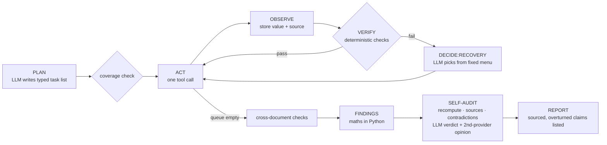

# Spend Radar

**An agent that tells a finance team where competitors out-invest them in people, and shows its work.** Every number in its report has a source, and before reporting, the agent tries to disprove its own findings.

Built solo by team **qwep** (Akarsh Dhingra) during **neatHack**, 10–12 Oct 2026. Uses **neatlogs** (tracing), **Entire** (checkpoints, code graph, trails and runners) and **cfo.ai** (business plan).

> The company in the demo, *Acme Observability Inc.*, is **fictional**. Its finance files are generated by `scripts/make_acme_data.py`. The competitors are real; their data comes live from Crustdata.


**Evidence site (live):** https://akarsh-dhingra.github.io/SpeedRadar-NeetHack/ — every scored run, the before/after case studies, the neatlogs and Entire pages, and the cfo.ai plan. Each judging requirement is mapped on its overview page.

Sample output: [`evidence/sample-report/report.md`](evidence/sample-report/report.md) (evidence run 1010-7bf26d).

## The problem

Finance teams budget against their own ledger, not the market. They find out a competitor doubled its ML team, or that their own marketing team is out of line with peers, a quarter too late. The data exists (headcount by function, hiring, funding), but turning it into a budget comparison you can defend takes days of manual work.

## What the agent does, end to end

**Input:** a folder of finance files (a budget spreadsheet, invoice PDFs, a spend policy, a salary table) and a list of competitors.
**Output:** `runs/<id>/report.md`, which contains:
- **per category** (engineering, ML/AI, sales, marketing): Acme's share of headcount vs the competitor median range, whether the policy is met, and the gap in people and dollars (an estimate)
- **internal checks:** budget and invoice totals that don't add up, mis-categorised invoices, infra invoices over budget
- an **Overturned claims** section, listing findings the agent disproved itself
- a numbered **source for every number** (file + sheet/row/page, or Crustdata endpoint + field + fetch time)
- the **recovery log** (what failed, the options, what the LLM chose, and what a fixed rule would have chosen)

## How it works




**Who decides what.**
- **The LLM decides:** the plan, which recovery action to take from a fixed menu (`reparse_alt`, `narrow_range`, `fetch_more_signal`, `substitute_competitor`, `mark_low_confidence`, `skip`), and the audit verdicts.
- **Python decides:** how tasks run, **all arithmetic**, retry caps (3 per task), Crustdata credit caps (60 per run), and LLM quota.

| Focus area | How it shows up | Trace |
|---|---|---|
| Planning | `plan` span: an LLM task list validated against a Pydantic schema; `verify:plan_coverage` adds anything the plan missed | `288f07d84bb84e15754a241eef40d779` |
| Tool use | list_files, read_spreadsheet, read_pdf (text / LLM), crustdata_company, crustdata_jobs, classify_titles; each is a `TOOL` span | same |
| State | `RunState` saved atomically after every step (`runs/<id>/state.json`); `resume` continues a killed run in the same neatlogs session | `522dfe5f0903595439c960a5e3b081c6` ([resume after crash](evidence/recovery/resume-after-crash.md)) |
| Context | every figure keeps its source and the report cites it; each run also records its commit and Entire checkpoint; prompts are versioned templates on every LLM span | `93ce24c6097db7d0ab7d5b90e1dcba4b` |
| Execution | one tool per task; tasks whose inputs aren't ready are deferred; every task outcome is a neatlogs `log()` step | `93ce24c6097db7d0ab7d5b90e1dcba4b` |
| Recovery | `decide:recovery` spans record the options offered, the choice, the rule default, and the reason; fallback across models/providers; Crustdata backoff + stale-cache fallback; resume after a crash | `evidence/recovery/` |
| Verification | totals within 1%, ≥ 2 independent signals, signal agreement, vendor-category consistency, no unsourced numbers | `verify:*` spans |
| Iteration | five case studies with before/after runs; every change since 11 Oct reviewed on an Entire trail | `evidence/case-studies/`, [trails](https://entire.io/gh/akarsh-dhingra/SpeedRadar-NeetHack/trails/2) |

**Confidence is computed, never typed in:** `confidence = checks × signals × freshness` (`spendradar/verify.py`).
- `checks` = passed / total checks behind the finding.
- `signals` = min(1, n_signals / 2) × agreement between signals.
- `freshness` = 1 up to 90 days old, falling to 0.5 at 365 days.
- An audit downgrade halves the score; an overturn sets it to 0.

## How we used the three tools

### neatlogs: tracing is the debugger
- Every Gemini call is auto-traced (`instrumentations=["google_genai"]`). OpenRouter calls, tool calls, `verify:*`, `decide:recovery`, `fallback:<model>`, `audit:<finding>` and `fault:injected:*` are custom spans.
- Runs are tagged `sha:<commit>`, `run:<id>`, `variant:<label>`, `evidence`, `inject:<fault>`, `fixture`. `session_id` = run id, so a resumed run groups with its first trace.
- Secrets are masked client-side before export (`mask=` callback, unit-tested).
- **Every bug fix below started from a trace.** Trace list: [`evidence/traces.md`](evidence/traces.md).
- **Evals and detections live in neatlogs too.** `spendradar eval` publishes each scorecard as a `spendradar_eval` trace: one `eval:run` span per run, with PASS/FAIL and a link to that run's trace, plus one `eval:planted_error` span per planted error. A detection group ("Spend Radar") flags failed evals, missed planted errors, LLM 400s, competitor substitution, fallback hops, non-default recoveries and self-audit overturns: [`evidence/neatlogs/evals-and-detections.md`](evidence/neatlogs/evals-and-detections.md).

### Entire: context for the coding agent
- Every commit by the coding agent carries an `Entire-Checkpoint` trailer that links it to the prompt and transcript behind it. Checkpoints are pushed with the repo.
- `entire graph search` / `impact` were used to locate and size changes, e.g. the callers of `decide_recovery` before changing the recovery menu.
- **`spendradar explain <trace_id | run_id>`: from a neatlogs span to the agent session that wrote the code.** For each failing span (or `--span decide:recovery`) it writes a dossier. Each dossier holds the span's input, output and error; the exact code line (refined to the line that raises that error); `entire why` (commit, Entire checkpoint, coding-agent session, model, and the prompt that produced the line, secret-scrubbed); and `entire graph impact` (callers that a fix would affect). Auto-instrumented LLM spans resolve through their parent span. On the corrupt-PDF bug the chain closes: neatlogs auto-triage flagged the Gemini 400 → `read_pdf` → the guard at `files.py:139` → checkpoint `01M4K4TJ…`, whose prompt *is* the neatlogs triage task. Dossiers: [`evidence/explain/`](evidence/explain/).
- **Code provenance on every run.** Report headers, the neatlogs root span (`spendradar.code.*`) and eval scorecards record the commit and the nearest Entire checkpoint, so a number links to its source, the source to its trace, and the trace to the code and the session that wrote it.
- **Trails and runners.** Each work item since 11 Oct gets a branch and a trail. Six runners (risk, confidence, drift, security, review, summary), tailored to this repo with `entire runner setup` (`.entire/runners/`), review every trail: [#1 provenance](https://entire.io/gh/akarsh-dhingra/SpeedRadar-NeetHack/trails/1), [#2 case study 05](https://entire.io/gh/akarsh-dhingra/SpeedRadar-NeetHack/trails/2), [#3 explain](https://entire.io/gh/akarsh-dhingra/SpeedRadar-NeetHack/trails/3). On #2 the review runner caught a real gap before merge: news evidence was skipped when signals disagreed. Fixed in `a16758f`; see case study 05.
- Evidence: [`evidence/entire/`](evidence/entire/).

### cfo.ai: a business plan from measured costs
- Unit costs are **measured**: tokens per run from evidence runs × the published paid price of the same model. We developed on free tiers, so actual spend was $0.
- Inputs: [`business/inputs.md`](business/inputs.md), [`business/unit_costs.md`](business/unit_costs.md). Prompt given to cfo.ai's Ari: [`business/cfoai_prompt.md`](business/cfoai_prompt.md).
- Plan: [`business/cfoai_plan.md`](business/cfoai_plan.md), with the cfo.ai exports in [`business/cfoai/`](business/cfoai/) and a [shared page in cfo.ai](https://cfo.ai/s/lwDIEZtRrqJOM07Z). It covers 24 months in two scenarios. Base turns cash-flow positive in month 15, with a cash low of $7,149 and a 57.7% gross margin. Growth turns positive in month 8, with a 71.4% margin.
- What it showed: Crustdata competitor data is about 99% of the cost of serving a customer, so caching it decides the margin. With no caching, the Team tier keeps 7.1% of its revenue (Base). Founder salary, tools and starting cash in the plan are placeholders.
- Cross-checked: [`business/make_cfoai_sheet.py`](business/make_cfoai_sheet.py) rebuilds the model in Python and matches the cfo.ai export on every month to within $0.01.

## Results so far

All numbers come from scorecards in [`evidence/evals/`](evidence/evals/).

| Run | Commit | Planted errors caught | Unsupported numbers | Peers kept | Crustdata credits |
|---|---|---|---|---|---|
| 1010-b31657 (before fix) | 11a5108 | 5/5 | 0 | 2/5 | 26.6 |
| 1010-7bf26d (after fix, evidence) | 22f00b0 | 5/5 | 0 | 5/5 | 5.4 |
| 5 evidence runs on gpt-5-nano, 0 fallback hops | bb61e37 | 5/5 in all 5 | 0 | 5/5 | 0 (cached) |
| fixture run (Sentry marketing ×5 planted) | bb61e37 | 6/6 | 0 | 5/5 | 0 (cached) |
| 5 evidence runs after case study 05 | bb2fb2f | 5/5 in all 5 | 0 | 5/5 | 0 (cached) |
| final run on merged main (1011-334cde) | 61e39d8 | 5/5 | 0 | 5/5 | 0 (cached) |

**Held-out companies** ([case study 04](evidence/case-studies/04-held-out-companies.md)): six more fictional companies in five other industries, built after the agent and never used to tune it. The latest finished run of all seven companies catches every planted error with 0 false alarms (`summary` in [`evidence/frontend_data.json`](evidence/frontend_data.json); per-run values in [`evidence/evals/README.md`](evidence/evals/README.md)). Fault-injected runs (Crustdata 429 + LLM 429) on Acme, Ledgerly and Bastion still caught every planted error.

Case studies (each n = 1 per side unless stated, with caveats):
- [01: reasoning calls took ~2 minutes each](evidence/case-studies/01-unbounded-llm-latency.md). Mean reasoning-call latency went from 120.9 s to 6.5 s after adding a per-call timeout with fallback.
- [02: one weak category threw away 3 of 5 peers](evidence/case-studies/02-competitor-substitution.md). Substitutions went from 3 to 0, and credits from 26.6 to 5.4.
- [03: bugs that only showed on fallback models](evidence/case-studies/03-fallback-model-quality.md). Runs that crashed went from 1/3 to 0/3, and the mis-categorised invoice from caught 0/3 to 3/3 on the main model.
- [04: held-out companies](evidence/case-studies/04-held-out-companies.md). Exposed a missing duplicate-invoice check, a missed one-off mis-categorised invoice, Windows path bugs and an audit that ignored its own line-item check. Acme's mis-categorised invoice after that last fix: caught in 3 of 3 runs (before: 1 of 2).
- [05: same data, three different audit verdicts](evidence/case-studies/05-audit-verdict-variance.md). n = 5 per side, same models, 0 fallback hops: the ML/AI verdict went from 3 different verdicts across 5 identical runs to the same verdict in 5 of 5, with planted errors still 5/5 and the fixture 6/6. An Entire trail runner caught a gap in the first version of this fix (news evidence was skipped); fixed before merge.

Paid-equivalent cost per run (n = 5, gpt-5-nano): **$0.0285 LLM** (range $0.0270–$0.0296) **+ 20.8 Crustdata credits** with no cache.

## See the evidence

[`site/`](site/) is a static site built from every scored run (`site/data.js`, regenerated by `python -m spendradar export`). Live at https://akarsh-dhingra.github.io/SpeedRadar-NeetHack/ (deployed from `site/` on every push), or open `site/index.html` locally; no server needed. It shows the generalisation matrix across 7 companies, findings the self-audit overturned, a step-by-step replay of each run, every recovery decision, before/after pairs from the case studies, the cfo.ai plan, a neatlogs page (detections, evals, the auto-triage fix, every trace) and an Entire page (checkpoints, trails with runner findings, `explain` dossiers). Its overview maps each judging requirement to where the evidence is. Design system: Audit Console; the Motion switch in the top bar turns the animations off.

## Run it yourself

```bash
uv sync                                  # Python 3.12
cp .env.example .env                     # NEATLOGS_API_KEY, GEMINI_API_KEY, OPENROUTER_API_KEY, CRUSTDATA_API_KEY
uv run python scripts/make_acme_data.py  # regenerate the fictional data (already committed)
uv run python -m spendradar run data/acme             # full run → runs/<id>/report.md
uv run python -m spendradar run data/acme --evidence  # LLM cache off, tagged as evidence
uv run python -m spendradar run data/acme --inject crustdata:429 --inject llm:429
uv run python -m spendradar run data/acme --crash-after-step 15 && uv run python -m spendradar resume <id>
uv run python -m spendradar eval --n 3 --evidence     # scorecard → evidence/evals/ + a spendradar_eval trace in neatlogs (--no-neatlogs to skip)
uv run python -m spendradar ledger                    # today's free-tier quota use
uv run pytest
ln -sf ../../scripts/pre-commit .git/hooks/pre-commit # gitleaks + .env-value secret scan
```

## Limitations (honest)

- **Estimates.** Competitor people cost = Crustdata headcount by role × *Acme's* loaded cost (an assumption, `data/acme/salary_table.csv`). The comparison covers **people cost only**; infra/cloud is checked against Acme's own budget only.
- **ML/AI is the weakest estimate.** Crustdata has no ML role, so ML share comes from LLM-classified job titles. Competitor signals for it disagree, so since case study 05 the self-audit always downgrades it (earlier runs overturned it in 1010-b31657 and 1010-a32118).
- **Fictional company data.** Acme and its vendors are invented; only competitor data is real.
- **Crustdata coverage.** Function timeseries for large companies stop at 2025-11 (the freshness penalty applies). Chronosphere has no hiring data.
- **LLM providers.** The main model is OpenAI gpt-5-nano (hackathon-provided credits). Fallbacks are Gemini free tier and OpenRouter `:free` models, which may use prompts for training. Only fictional and public data was sent; **real customer finance data must not go through free tiers.** Daily quotas are small: `gemini-3.8-flash` stopped after 15 requests on 10 Oct.
- **Small samples.** Case studies 01–02 are n = 1 per side with different model mixes; 04 is mostly n = 1–3. Case study 05 and the gpt-5-nano batch are n = 5 with 0 fallback hops.
- **Audit variance (fixed, narrow).** On identical data the ML/AI verdict used to vary (confirmed / overturned / downgraded). [Case study 05](evidence/case-studies/05-audit-verdict-variance.md) made disagreeing-signal findings deterministic (always downgraded). The LLM judge still decides findings with news evidence or mis-categorisation flags, and those can still vary.
- **Business costs are paid-equivalent estimates**, not invoices.

## Built during neatHack

Build log: [`hackathon.md`](hackathon.md) · posts: [`evidence/build-in-public.md`](evidence/build-in-public.md) · #neatHack

## Submission

- **Team:** qwep (Akarsh Dhingra, solo) · **Project:** Spend Radar
- **Repo:** https://github.com/akarsh-dhingra/SpeedRadar-NeetHack
- **Evidence site:** https://akarsh-dhingra.github.io/SpeedRadar-NeetHack/
- **Demo video:** {demo link}
- **Entire checkpoint:** [`01M4K4TJNC7JY16812XTZKSBKA`](https://entire.io/gh/akarsh-dhingra/SpeedRadar-NeetHack/commit/8d11308585870c0d1f39e178660016368e7b7d3c): the fix for the bug neatlogs auto-triage found. Its session prompt is the triage task itself (see `spendradar explain`, [`evidence/explain/`](evidence/explain/)).
- **Entire trails:** [#1](https://entire.io/gh/akarsh-dhingra/SpeedRadar-NeetHack/trails/1) · [#2](https://entire.io/gh/akarsh-dhingra/SpeedRadar-NeetHack/trails/2) · [#3](https://entire.io/gh/akarsh-dhingra/SpeedRadar-NeetHack/trails/3)
- **cfo.ai plan:** [`business/cfoai_plan.md`](business/cfoai_plan.md), exports in [`business/cfoai/`](business/cfoai/)
