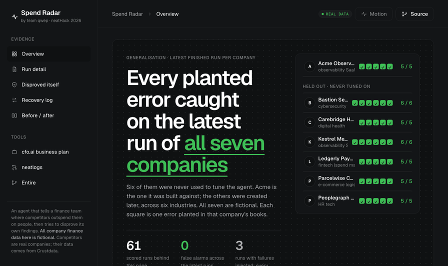
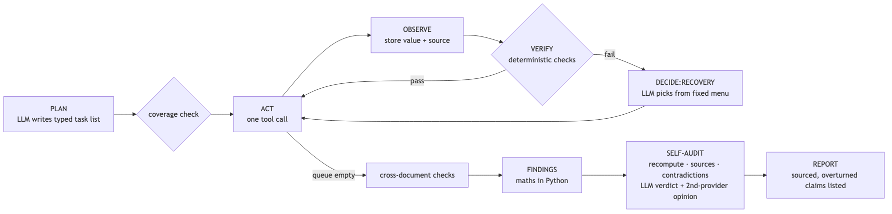
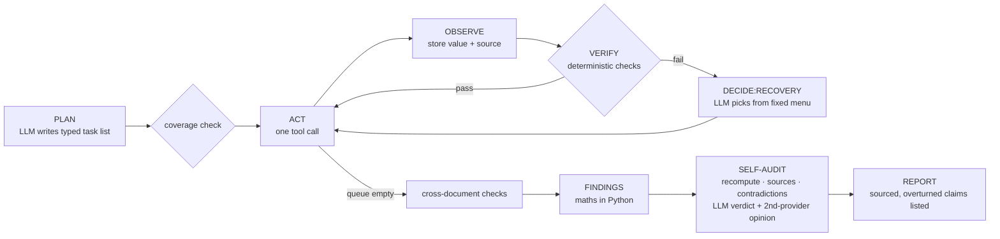
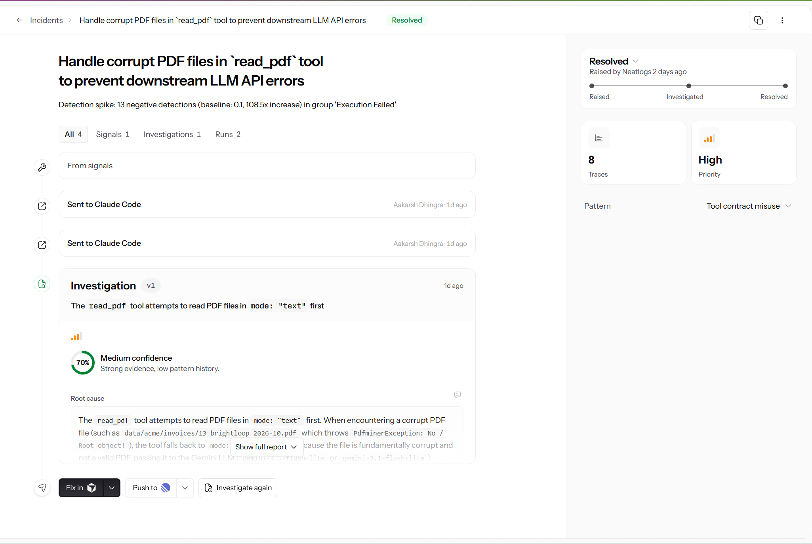

<div align="center">

# Spend Radar

**Find out where competitors outspend you on people, before next quarter tells you.**

An AI agent that reads a company's finance files, pulls real competitor headcount, and reports where the gaps are.
Every number has a source. Before it reports a finding, it tries to prove the finding wrong.

[](evidence/build-in-public.md)
[](#submission)
[](#neatlogs-found-our-bugs-before-we-did)
[](#entire-kept-the-coding-agents-memory)
[](#cfoai-turned-measured-costs-into-a-business-plan)

**[Demo video](#submission)** · **[Live evidence site](https://akarsh-dhingra.github.io/SpeedRadar-NeetHack/)** · **[Sample report](evidence/sample-report/report.md)** · **[Case studies](evidence/case-studies/)** · **[Business plan](business/cfoai_plan.md)**



</div>

> The company in the demo, *Acme Observability Inc.*, is **fictional**. `scripts/make_acme_data.py` generates its finance files. The competitors are real, and their data comes live from Crustdata.

## At a glance

| | |
|---|---|
| **7 companies, 6 never seen in development** | The latest run on each caught every planted error, with 0 false alarms |
| **77 scored runs** | Across 7 companies, with scorecards in [`evidence/evals/`](evidence/evals/) and trace links in [`evidence/traces.md`](evidence/traces.md) |
| **16 findings overturned, 73 downgraded** | By the agent's own self-audit, before they reached a report |
| **439 of 837 recovery decisions** | Where the model picked something other than the fixed rule's default |
| **24 real public invoices** | Silent wrong totals per pass went from 2 → 0 and 4 → 0 after one fix ([case study 06](evidence/case-studies/06-real-invoices-gross-vs-net.md)) |
| **91 Entire checkpoints, 6 review trails** | Runners caught 4 real bugs; all 4 are fixed |
| **$0.0285 LLM cost per run** | Paid-equivalent, measured on 5 runs. Competitor data is about 99% of the cost of serving a customer |

All counts come from [`evidence/frontend_data.json`](evidence/frontend_data.json) (`summary`, `entire`) and the linked case studies.

## The problem

Finance teams budget against their own ledger, not the market. They find out a competitor doubled its ML team, or that their own marketing team is out of line with peers, a quarter too late. The data exists (headcount by function, hiring, funding). Turning it into a budget comparison you can defend takes days of manual work.

## What the agent does

You give it a folder of finance files (a budget spreadsheet, invoice PDFs, a spend policy, a salary table) and a list of competitors. It writes `runs/<id>/report.md` with:

- **Per category** (engineering, ML/AI, sales, marketing): your share of headcount against the competitor median range, whether your policy is met, and the gap in people and dollars (an estimate).
- **Internal checks.** Budget and invoice totals that don't add up, mis-categorised invoices, infra invoices over budget.
- **Overturned claims.** Findings the agent disproved itself, listed instead of hidden.
- **A source for every number.** File plus sheet, row or page, or the Crustdata endpoint, field and fetch time.
- **The recovery log.** What failed, the options offered, what the model chose, and what a fixed rule would have chosen.

See a real one: [`evidence/sample-report/report.md`](evidence/sample-report/report.md).

## How it works





**The LLM decides** the plan, which recovery action to take from a fixed menu (`reparse_alt`, `narrow_range`, `fetch_more_signal`, `substitute_competitor`, `mark_low_confidence`, `skip`), and the audit verdicts.

**Python decides** how tasks run, **all arithmetic**, retry caps (3 per task), Crustdata credit caps (60 per run), and LLM quota.

**Confidence is computed, never typed in.** `confidence = checks × signals × freshness` ([`spendradar/verify.py`](spendradar/verify.py)).
`checks` is passed / total checks behind the finding. `signals` is min(1, n_signals / 2) × agreement between signals. `freshness` is 1 up to 90 days old, falling to 0.5 at 365 days. An audit downgrade halves the score, and an overturn sets it to 0.

<details>
<summary><b>The eight focus areas, each with a trace</b></summary>

| Focus area | How it shows up | Trace |
|---|---|---|
| Planning | `plan` span: an LLM task list validated against a Pydantic schema; `verify:plan_coverage` adds anything the plan missed | `288f07d84bb84e15754a241eef40d779` |
| Tool use | list_files, read_spreadsheet, read_pdf (text / LLM), crustdata_company, crustdata_jobs, classify_titles; each is a `TOOL` span | same |
| State | `RunState` saved atomically after every step (`runs/<id>/state.json`); `resume` continues a killed run in the same neatlogs session | `522dfe5f0903595439c960a5e3b081c6` ([resume after crash](evidence/recovery/resume-after-crash.md)) |
| Context | every figure keeps its source and the report cites it; each run also records its commit and Entire checkpoint; prompts are versioned templates on every LLM span | `93ce24c6097db7d0ab7d5b90e1dcba4b` |
| Execution | one tool per task; tasks whose inputs aren't ready are deferred; every task outcome is a neatlogs `log()` step | `93ce24c6097db7d0ab7d5b90e1dcba4b` |
| Recovery | `decide:recovery` spans record the options offered, the choice, the rule default, and the reason; fallback across models/providers; Crustdata backoff + stale-cache fallback; resume after a crash | [`evidence/recovery/`](evidence/recovery/) |
| Verification | totals within 1%, ≥ 2 independent signals, signal agreement, vendor-category consistency, no unsourced numbers | `verify:*` spans |
| Iteration | seven case studies with before/after runs; every change since 11 Oct reviewed on an Entire trail | [`evidence/case-studies/`](evidence/case-studies/), [trails](#entire-kept-the-coding-agents-memory) |

</details>

## How we used the three tools

### neatlogs found our bugs before we did



neatlogs raised this incident on its own. It saw a spike of 13 negative detections in *Execution Failed* (108.5× the baseline). Its investigation traced the cause to a corrupt invoice that `read_pdf` still passed to Gemini, which returned a 400. We sent it to Claude Code and fixed it in [`8d11308`](https://github.com/akarsh-dhingra/SpeedRadar-NeetHack/commit/8d11308585870c0d1f39e178660016368e7b7d3c). In the after trace, that invoice fails in 0.8 ms with no LLM call (before `36362eb966cdbb85dcb2fb1b280e1034`, after `953bb991e2547b1591bb2bb6adb555b8`).

- Every Gemini call is auto-traced (`instrumentations=["google_genai"]`). OpenRouter calls, tool calls, `verify:*`, `decide:recovery`, `fallback:<model>`, `audit:<finding>` and `fault:injected:*` are custom spans.
- Runs are tagged `sha:<commit>`, `run:<id>`, `variant:<label>`, `evidence`, `inject:<fault>` and `fixture`. `session_id` is the run id, so a resumed run groups with its first trace.
- Secrets are masked client-side before export (a `mask=` callback with a unit test).
- **Every bug fix in the case studies started from a trace.** Trace list: [`evidence/traces.md`](evidence/traces.md).
- **Evals and detections live in neatlogs too.** `spendradar eval` publishes each scorecard as a `spendradar_eval` trace, with one `eval:run` span per run (PASS/FAIL plus a link to that run's trace) and one `eval:planted_error` span per planted error. A detection group ("Spend Radar") flags failed evals, missed planted errors, LLM 400s, competitor substitution, fallback hops, non-default recoveries and self-audit overturns. See [`evidence/neatlogs/evals-and-detections.md`](evidence/neatlogs/evals-and-detections.md).

### Entire kept the coding agent's memory

- **91 checkpoints.** Every commit by the coding agent carries an `Entire-Checkpoint` trailer linking it to the prompt and transcript behind it. Checkpoints are pushed with the repo.
- **`spendradar explain <trace_id | run_id>` goes from a neatlogs span to the session that wrote the code.** For each failing span it writes a dossier with the span's input, output and error, and the exact code line. It adds `entire why` (commit, checkpoint, coding-agent session, model, and the prompt that produced the line, secret-scrubbed) and `entire graph impact` (callers a fix would affect). On the corrupt-PDF bug the chain closes: neatlogs flagged the Gemini 400 → `read_pdf` → the guard at `files.py:139` → checkpoint `01M4K4TJ…`, whose prompt *is* the neatlogs triage task. Dossiers: [`evidence/explain/`](evidence/explain/).
- **Code provenance on every run.** Report headers, the neatlogs root span (`spendradar.code.*`) and eval scorecards record the commit and the nearest Entire checkpoint. A number links to its source, the source to its trace, and the trace to the code and the session that wrote it.
- **6 review trails, 4 real bugs caught, all fixed.** Each work item since 11 Oct got a branch and a trail. Six runners (risk, confidence, drift, security, review, summary), set up for this repo with `entire runner setup` ([`.entire/runners/`](.entire/runners/)), review every trail.

| Trail | What it covered | Runner findings |
|---|---|---|
| [#1](https://entire.io/gh/akarsh-dhingra/SpeedRadar-NeetHack/trails/1) | Code provenance: every run links to its Entire checkpoint | none |
| [#2](https://entire.io/gh/akarsh-dhingra/SpeedRadar-NeetHack/trails/2) | Case study 05: deterministic audit verdicts | medium: news evidence was skipped when signals disagreed. Fixed in `a16758f` |
| [#3](https://entire.io/gh/akarsh-dhingra/SpeedRadar-NeetHack/trails/3) | `spendradar explain` | low: trace pagination could loop forever. Fixed in `62c6b69` |
| [#4](https://entire.io/gh/akarsh-dhingra/SpeedRadar-NeetHack/trails/4) | Printed-net invoice totals (case study 07) | none |
| [#5](https://entire.io/gh/akarsh-dhingra/SpeedRadar-NeetHack/trails/5) | Real-invoice eval (case studies 06, 07) | none |
| [#6](https://entire.io/gh/akarsh-dhingra/SpeedRadar-NeetHack/trails/6) | Evidence site + export | medium + low: an export crash and a hardcoded label. Both fixed in `bd079ca` |

Evidence: [`evidence/entire/`](evidence/entire/).

### cfo.ai turned measured costs into a business plan

Unit costs are **measured**, not guessed: tokens per run from evidence runs × the published paid price of the same model. We built on free tiers, so actual spend was $0. The plan covers 24 months across 7 scenarios (read from the cfo.ai model into `business.cfoai_model` in [`evidence/frontend_data.json`](evidence/frontend_data.json)):

| Scenario | Cash-flow positive | Lowest cash | Gross margin, month 24 |
|---|---|---|---|
| Base | Jan 2028 (month 15) | $7,149 | 57.7% |
| Growth | Jun 2027 (month 8) | $14,615 | 71.4% |
| Downside | not within 24 months | −$8,532 | 29.5% |
| Team uncached cap | Nov 2027 (month 13) | $8,835 | 69.3% |
| Team repriced | Nov 2027 (month 13) | $8,889 | 62.3% |
| Industry mix | Jan 2028 (month 15) | $7,626 | 60.1% |
| Managed review (we review flagged invoices) | Jan 2028 (month 15) | $6,127 | 52.9% |

What it showed us: Crustdata competitor data is about 99% of the cost of serving a customer, so caching it decides the margin. The Downside case never turns positive, and founder salary, tools and starting cash are placeholders.

Plan: [`business/cfoai_plan.md`](business/cfoai_plan.md) · exports: [`business/cfoai/`](business/cfoai/) · [shared page in cfo.ai](https://cfo.ai/s/lwDIEZtRrqJOM07Z) · inputs: [`business/inputs.md`](business/inputs.md), [`business/unit_costs.md`](business/unit_costs.md) · prompt given to Ari: [`business/cfoai_prompt.md`](business/cfoai_prompt.md). [`business/make_cfoai_sheet.py`](business/make_cfoai_sheet.py) rebuilds the model in Python and matches the cfo.ai export on every month to within $0.01.

## Results

All numbers come from scorecards in [`evidence/evals/`](evidence/evals/).

| Run | Commit | Planted errors caught | Unsupported numbers | Peers kept | Crustdata credits |
|---|---|---|---|---|---|
| 1010-b31657 (before fix) | 11a5108 | 5/5 | 0 | 2/5 | 26.6 |
| 1010-7bf26d (after fix, evidence) | 22f00b0 | 5/5 | 0 | 5/5 | 5.4 |
| 5 evidence runs on gpt-5-nano, 0 fallback hops | bb61e37 | 5/5 in all 5 | 0 | 5/5 | 0 (cached) |
| fixture run (Sentry marketing ×5 planted) | bb61e37 | 6/6 | 0 | 5/5 | 0 (cached) |
| 5 evidence runs after case study 05 | bb2fb2f | 5/5 in all 5 | 0 | 5/5 | 0 (cached) |
| final run on merged main (1011-334cde) | 61e39d8 | 5/5 | 0 | 5/5 | 0 (cached) |

**Held-out companies** ([case study 04](evidence/case-studies/04-held-out-companies.md)): six more fictional companies in five other industries, built after the agent and never used to tune it. The latest finished run of all seven catches every planted error with 0 false alarms. Fault-injected runs (Crustdata 429 + LLM 429) on Acme, Ledgerly and Bastion still caught every planted error.

Paid-equivalent cost per run (n = 5, gpt-5-nano): **$0.0285 LLM** (range $0.0270–$0.0296) **+ 20.8 Crustdata credits** with no cache.

<details>
<summary><b>Seven case studies: each bug, its fix, and the numbers before and after</b></summary>

Each is n = 1 per side unless stated, with caveats in the file.

- [01: reasoning calls took ~2 minutes each](evidence/case-studies/01-unbounded-llm-latency.md). Mean reasoning-call latency went from 120.9 s to 6.5 s after adding a per-call timeout with fallback.
- [02: one weak category threw away 3 of 5 peers](evidence/case-studies/02-competitor-substitution.md). Substitutions went from 3 to 0, and credits from 26.6 to 5.4. **Rerun at n = 5 per side** (same code, models and data; before = fix reverted): peers kept went from 2 of 5 in all 5 runs to 5 of 5 in all 5, substitutions from 3 per run to 0, with 0 fallback hops.
- [03: bugs that only showed on fallback models](evidence/case-studies/03-fallback-model-quality.md). Runs that crashed went from 1/3 to 0/3, and the mis-categorised invoice from caught 0/3 to 3/3 on the main model.
- [04: held-out companies](evidence/case-studies/04-held-out-companies.md). Exposed a missing duplicate-invoice check, a missed one-off mis-categorised invoice, Windows path bugs and an audit that ignored its own line-item check. Acme's mis-categorised invoice after that last fix: caught in 3 of 3 runs (before: 1 of 2).
- [05: same data, three different audit verdicts](evidence/case-studies/05-audit-verdict-variance.md). n = 5 per side, same models, 0 fallback hops. The ML/AI verdict went from 3 different verdicts across 5 identical runs to the same verdict in 5 of 5, with planted errors still 5/5 and the fixture 6/6. An Entire trail runner caught a gap in the first version of this fix (news evidence was skipped), fixed before merge.
- [06: real invoices, gross vs net](evidence/case-studies/06-real-invoices-gross-vs-net.md). The invoice reader on 24 **real** public FCC broadcast-ad invoices with verified totals ([amazon/ConfBench](https://huggingface.co/datasets/amazon/ConfBench), CC BY-NC 4.0). The LLM reader often copied *Net Amount Due* instead of the gross total. After a prompt fix, n = 3 passes per side: wrong totals that nothing flags went from 2 per pass to 0 on the 12 invoices used to write the fix, and from 4 per pass to 0 on 12 held-out invoices. Cost: 7 of 12 held-out invoices are now flagged for review although their total is right.
- [07: line items printed net of commission](evidence/case-studies/07-printed-net-line-items.md). The invoice check now also accepts line items that add up to the printed net amount due (Python arithmetic; unchanged for invoices without one). Correct-but-flagged invoices went from 7 to 2 per pass on the held-out set and from 2–3 to 1 on the first set. **On a third fresh set of 12 it made no clear difference** (within run-to-run noise; its only silent error is one hard invoice both versions misread). Same commit: the job-title classifier now survives a schema-echoed reply that cost a competitor's ML/AI estimate in 2 of 10 runs.

</details>

## See the evidence

**[akarsh-dhingra.github.io/SpeedRadar-NeetHack](https://akarsh-dhingra.github.io/SpeedRadar-NeetHack/)** is a static site built from every scored run (`site/data.js`, regenerated by `python -m spendradar export`, deployed from [`site/`](site/) on every push). It shows:

- the results across all 7 companies
- the findings the self-audit overturned
- a step-by-step replay of each run, with every recovery decision
- before/after pairs from the case studies
- the cfo.ai plan
- a neatlogs page (detections, evals, the auto-triage fix, every trace) and an Entire page (checkpoints, trails with runner findings, `explain` dossiers)

Its overview maps each judging requirement to where the evidence is. You can also open `site/index.html` locally; no server needed.

## Run it yourself

```bash
uv sync                                  # Python 3.12
cp .env.example .env                     # NEATLOGS_API_KEY, GEMINI_API_KEY, OPENROUTER_API_KEY, CRUSTDATA_API_KEY
uv run python scripts/make_acme_data.py  # regenerate the fictional data (already committed)
uv run python -m spendradar run data/acme             # full run → runs/<id>/report.md
uv run python -m spendradar run data/acme --evidence  # LLM cache off, tagged as evidence
uv run python -m spendradar run data/acme --inject crustdata:429 --inject llm:429
uv run python -m spendradar run data/acme --crash-after-step 15 && uv run python -m spendradar resume <id>
uv run python -m spendradar eval --n 3 --evidence     # scorecard → evidence/evals/ + a spendradar_eval trace in neatlogs (--no-neatlogs to skip)
uv run python -m spendradar ledger                    # today's free-tier quota use
uv run pytest
ln -sf ../../scripts/pre-commit .git/hooks/pre-commit # gitleaks + .env-value secret scan
```

## Limitations

- **Estimates.** Competitor people cost = Crustdata headcount by role × *Acme's* loaded cost (an assumption, `data/acme/salary_table.csv`). The comparison covers **people cost only**; infra/cloud is checked against Acme's own budget only.
- **ML/AI is the weakest estimate.** Crustdata has no ML role, so ML share comes from LLM-classified job titles. Competitor signals for it disagree, so since case study 05 the self-audit always downgrades it (earlier runs overturned it in 1010-b31657 and 1010-a32118).
- **Fictional company data.** Acme and its vendors are invented; only competitor data is real. The invoice reader alone was also tested on 24 real public invoices (case study 06). A full run on a real company's books has not been done.
- **Crustdata coverage.** Function timeseries for large companies stop at 2025-11 (the freshness penalty applies). Chronosphere has no hiring data.
- **LLM providers.** The main model is OpenAI gpt-5-nano (hackathon-provided credits). Fallbacks are Gemini free tier and OpenRouter `:free` models, which may use prompts for training. Only fictional and public data was sent; **real customer finance data must not go through free tiers.** Daily quotas are small: `gemini-3.8-flash` stopped after 15 requests on 10 Oct.
- **Small samples.** Case study 01 is n = 1 per side with different model mixes; 04 is mostly n = 1–3. Case studies 02 (rerun) and 05 and the gpt-5-nano batch are n = 5 per side with 0 fallback hops; 06 is n = 3 passes of 12 invoices per side.
- **Audit variance (fixed, narrow).** On identical data the ML/AI verdict used to vary (confirmed / overturned / downgraded). [Case study 05](evidence/case-studies/05-audit-verdict-variance.md) made disagreeing-signal findings deterministic (always downgraded). The LLM judge still decides findings with news evidence or mis-categorisation flags, and those can still vary.
- **Business costs are paid-equivalent estimates**, not invoices.

## Submission

| | |
|---|---|
| **Team** | qwep (Akarsh Dhingra, solo) |
| **Project** | Spend Radar |
| **Demo video** | {demo link} |
| **Repo** | https://github.com/akarsh-dhingra/SpeedRadar-NeetHack |
| **Evidence site** | https://akarsh-dhingra.github.io/SpeedRadar-NeetHack/ |
| **Entire checkpoint** | [`01M4K4TJNC7JY16812XTZKSBKA`](https://entire.io/gh/akarsh-dhingra/SpeedRadar-NeetHack/commit/8d11308585870c0d1f39e178660016368e7b7d3c), the fix for the bug neatlogs auto-triage found. Its session prompt is the triage task itself ([`evidence/explain/`](evidence/explain/)) |
| **Entire trails** | [#1](https://entire.io/gh/akarsh-dhingra/SpeedRadar-NeetHack/trails/1) · [#2](https://entire.io/gh/akarsh-dhingra/SpeedRadar-NeetHack/trails/2) · [#3](https://entire.io/gh/akarsh-dhingra/SpeedRadar-NeetHack/trails/3) · [#4](https://entire.io/gh/akarsh-dhingra/SpeedRadar-NeetHack/trails/4) · [#5](https://entire.io/gh/akarsh-dhingra/SpeedRadar-NeetHack/trails/5) · [#6](https://entire.io/gh/akarsh-dhingra/SpeedRadar-NeetHack/trails/6) |
| **cfo.ai plan** | [`business/cfoai_plan.md`](business/cfoai_plan.md), exports in [`business/cfoai/`](business/cfoai/) |
| **Build log** | [`hackathon.md`](hackathon.md) · posts: [`evidence/build-in-public.md`](evidence/build-in-public.md) · #neatHack |

Built during neatHack, 10–12 Oct 2026. The demo video's presenter is a Live2D Inc. sample model ("Niziiro Mao"): this content uses sample data owned and copyrighted by Live2D Inc. The sample data are utilized in accordance with terms and conditions set by Live2D Inc. This content itself is created at the author's sole discretion.
